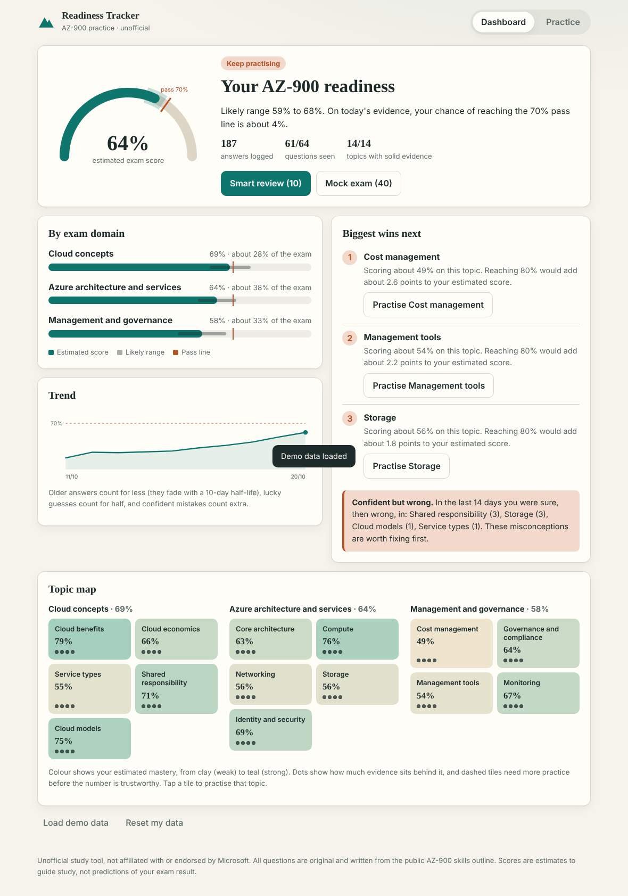
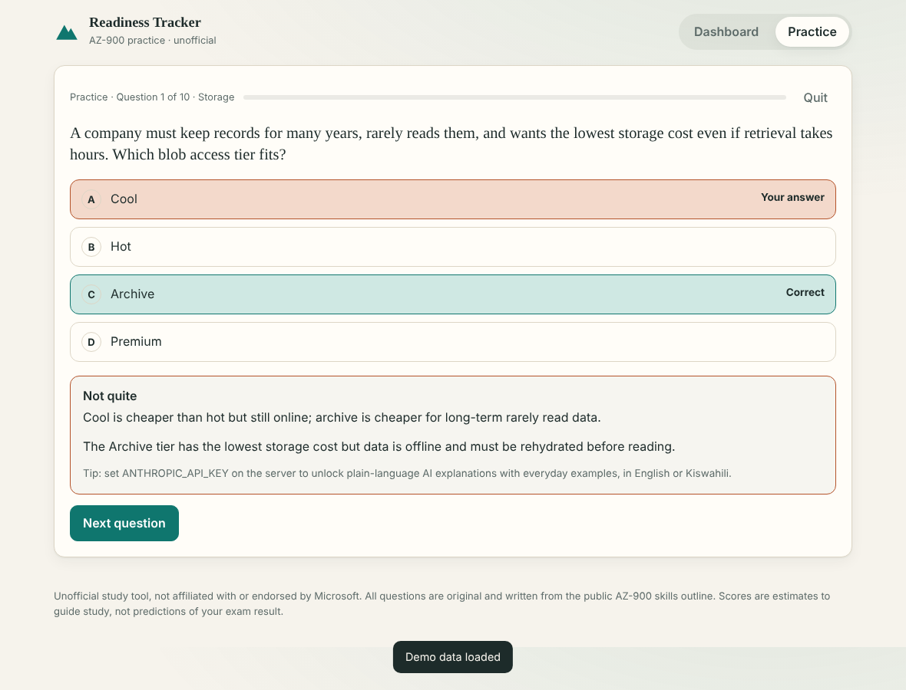

# AZ-900 Readiness Tracker

> **Unofficial study tool.** Not affiliated with, endorsed by, or sponsored by Microsoft. All 64 questions are original and written from the public AZ-900 skills outline on Microsoft Learn. No Microsoft logos are used.

Most learners finish a practice test with one number and no idea whether it means they should book the exam. **Readiness Tracker** turns every practice answer into an honest, topic-by-topic estimate of how ready you are, tells you what to study next, and shows its uncertainty instead of hiding it.

Built for the **#1MillionDevs Vibe Coding Hackathon: AZ-900 Exam Prep Edition** (challenge: *Progress / Readiness Tracker*, with a bonus *Study Planner*).

| Dashboard | Practice feedback |
|---|---|
|  |  |

## What makes it different

- **A score with error bars.** "64% (likely 59 to 68%), about a 4% chance of reaching the 70% pass line on today's evidence." Early on the range is wide; it narrows as you answer more.
- **Honest about guessing.** Before each answer you mark *I'm sure* or *Just guessing*. A lucky guess counts for little. A confident wrong answer counts extra and is flagged as a misconception.
- **Weighted like the exam.** Topic scores roll up into the three exam domains using the published weightings (25-30%, 35-40%, 30-35%).
- **Tells you where the points are.** "Biggest wins next" ranks topics by how many exam points you would gain by reaching 80%.
- **Forgetting is modelled.** Evidence fades with a 10-day half-life, so a topic you have not touched in weeks drifts back toward uncertainty.
- **Smart review (spaced repetition).** Picks questions from high-value weak topics, brings back anything you got wrong, and rests things you just got right.
- **Flexible practice and saved questions.** Choose a short or longer session, drill a domain or topic, save questions for later, and retry misses immediately from your results.
- **Exam-date study planner.** Give it your exam date, hours per week and study days. It builds a day-by-day schedule that puts time where it raises your score most, interleaves topics, adds a mock exam about a week out, and keeps the final day to light review of your weak spots and confident mistakes. Mark blocks done or skipped, move them to another day, and track completion.
- **Mock exam.** 40 questions sampled by exam weight, no feedback until the end, then a domain breakdown and review of every miss. An optional 45-minute timer helps you practise under time pressure.
- **Resumable sessions and exam review.** In-progress sessions save on this device. Mock exams include question navigation, answered/flagged states, keyboard navigation, a finish confirmation, and a review of unanswered questions.
- **Portable learner data.** Download a JSON backup with practice history, saved questions and planner progress, then import it on another browser. Import replaces the current practice history after confirmation.
- **Accessible progress views.** Topic status includes an evidence label as well as colour, and the dashboard includes recent practice activity.
- **Learning insights.** See first-attempt accuracy separately from repeat attempts, plus accuracy for answers marked sure versus guesses.
- **Adaptive learning path.** The Learn view orders exam topics using readiness gaps, exam weighting and evidence coverage. With no history, it starts with the exam domains in a sensible foundation-first order.
- **Azure architecture explainer.** A responsive diagram shows how a load balancer, application instances, cache and database fit together, with a practical cache-miss scenario.
- **Trust signals.** Every answer links to the matching official Microsoft Learn module, every question has a "report a problem" link, and the dashboard says plainly how many questions a person has reviewed against the current skills outline (July 20, 2026 at the time of writing).
- **It checks itself against reality.** Learners can report an official exam result or a Microsoft practice-assessment score; the server records what the tracker predicted *at that time* and `python -m app.calibration` shows whether the predictions hold up.
- **Installable.** Add it to a phone's home screen; the app shell loads instantly and the app tells you when you are offline. Practice itself needs the server (answers are never sent to the browser in advance).
- **Explain it simply (optional, Claude).** Re-explains a question in plain English or Kiswahili with an everyday East African analogy, grounded in the curated explanation so it cannot invent facts. See [docs/PROMPTS.md](docs/PROMPTS.md).

## Quick start

Requires Python 3.11+.

```bash
git clone <your-repo-url> az900-readiness-tracker
cd az900-readiness-tracker
python -m venv .venv && source .venv/bin/activate      # Windows: .venv\Scripts\activate
pip install -r requirements.txt          # or: pip install -r requirements.lock  (exact tested versions)
uvicorn app.main:app --reload
```

Open <http://127.0.0.1:8000>. Click **Load demo data** on the dashboard to see a populated example straight away.

Optional AI explanations:

```bash
export ANTHROPIC_API_KEY=sk-ant-...        # Windows PowerShell: $env:ANTHROPIC_API_KEY="..."
export ANTHROPIC_MODEL=claude-sonnet-5-5   # optional, this is the default
```

Without a key everything else works; the explain button is hidden. Explanations are cached per question, wrong choice, style and language, so API usage is bounded no matter how many people use the app.

### Docker

```bash
docker build -t az900-readiness .
docker run -p 8000:8000 -v az900data:/data -e ANTHROPIC_API_KEY=... az900-readiness
```

The image installs the exact versions in `requirements.lock`, runs as an unprivileged user, writes only to `/data`,
logs JSON lines, and has a built-in health check. Use `/api/ready` as the platform readiness probe (it checks the
database); `/api/health` is liveness only.

### Android APK release

This repo now includes a very small Android wrapper under [`android/`](android/) that loads the public backend URL in a `WebView`. It is designed to be built in GitHub Actions and uploaded as a signed release APK.

Workflow: [`.github/workflows/android-release.yml`](.github/workflows/android-release.yml)

- Manual run: GitHub → Actions → **Android release** → **Run workflow**
- Tag release: push a tag such as `v1.0.0` to trigger automatic APK creation and attach it to a GitHub Release
- Override backend URL: set the workflow input `backend_url` or edit the default in the workflow
- The release build requires a signing key. Create it once and keep a secure backup:

  ```powershell
  keytool -genkeypair -v -keystore release-key.jks -alias az900-tracker -keyalg RSA -keysize 2048 -validity 10000
  [Convert]::ToBase64String([IO.File]::ReadAllBytes("release-key.jks")) | Set-Clipboard
  ```

- In GitHub, open **Settings → Secrets and variables → Actions** and add these repository secrets:
  `ANDROID_KEYSTORE_BASE64` (the clipboard value), `ANDROID_KEYSTORE_PASSWORD`,
  `ANDROID_KEY_ALIAS` (for example, `az900-tracker`), and `ANDROID_KEY_PASSWORD`.
- Never commit the keystore or its passwords. The keystore is ignored by Git; losing it means future APKs cannot update installs signed with the old key.
- The workflow fails with a clear error if signing secrets are missing and only accepts an HTTPS backend URL.

The wrapper loads the configured backend URL (default is the public Render URL) and keeps the app in a single `WebView` for a stable APK packaging flow.

### Public demo on Render

This repository includes a Render Blueprint for deploying the app as a Docker web service. To create a public demo, push the repository to GitHub, sign in to Render, choose **New → Blueprint**, and connect this repository. Render reads `render.yaml` and builds the app; the health check uses `/api/ready`, and `TRUSTED_PROXY_HOPS=1` makes per-client rate limits see real client addresses behind Render's proxy.

The Blueprint uses Render's free instance for a prototype. Free instances spin down when idle and have an ephemeral filesystem, so practice history stored in SQLite can be lost when the service restarts, spins down, or redeploys. Use a persistent disk on a paid instance (the commented `disk:` block in `render.yaml`) if learner history must survive those events. AI explanations remain optional; no API key is needed for the core app.

## Configuration

All settings are environment variables, validated at startup (a bad value stops the app with a message naming it). See [`.env.example`](.env.example) for every option with defaults. The ones you are most likely to touch:

| Variable | Default | Purpose |
|---|---|---|
| `ANTHROPIC_API_KEY` | unset | Enables AI explanations. Everything else works without it |
| `EXPLAIN_DAILY_CAP` | `2000` | Maximum live model calls per UTC day (0 = unlimited). Cached answers are free |
| `DB_PATH` | `./readiness.db` | SQLite file (`/data/readiness.db` in Docker) |
| `TRUSTED_PROXY_HOPS` | `0` | Set to `1` behind exactly one proxy (Render, Fly, Heroku) so rate limits use the real client address |
| `RATE_LIMIT_PER_MIN` | `240` | Per-client budget for `/api`; import/export/reset/demo (`HEAVY_...`) and explain (`EXPLAIN_...`) have their own, tighter budgets |
| `LOG_JSON` / `LOG_LEVEL` | `false` / `INFO` | One JSON object per line for log aggregators |
| `ENABLE_DEMO` | `true` | Turn off `/api/demo/seed` on a real deployment |
| `FEEDBACK_URL` | unset | e.g. `https://github.com/you/repo/issues/new`. Turns on the "Report a problem with this question" links |
| `CONTACT_EMAIL` | unset | Shown on the `/privacy` page |

## Operations

* **Health:** `GET /api/health` (liveness, no I/O) and `GET /api/ready` (database + question bank; 503 when unavailable).
* **Tracing:** every response carries `X-Request-ID`; the same id is on every log line for that request. Access logs record the path only, never the query string, because the learner id is a bearer secret.
* **Backups:** `python -m app.db backup /path/to/copy.db` takes a consistent copy while the app is running. `python -m app.db version` shows the schema version.
* **Upgrades:** schema changes are numbered migrations applied automatically at startup; an older database upgrades in place, and a database from a *newer* app is refused instead of risked.
* **Is the estimate accurate?** `python -m app.calibration` compares predictions with reported exam results (reliability bins, Brier score against a naive baseline) and with practice-assessment scores (bias, mean error, correlation). It says plainly when there is not enough data to judge (under 30 exam results).
* **Privacy:** `/privacy` describes exactly what is stored; the Reset button deletes a learner's answers *and* reported results. If you run this publicly you are the data controller, so check that page against the laws that apply to you (for example Kenya's Data Protection Act or GDPR) and set `CONTACT_EMAIL`.
* **Failure behaviour:** see [docs/ARCHITECTURE.md](docs/ARCHITECTURE.md#what-happens-when) for what happens when the model API, the database, or a client misbehaves.

## How the readiness score works

Every answer is evidence about one of 14 topics. For each topic we keep a Beta distribution over "the chance you answer a question on this topic correctly".

| Signal | Effect |
|---|---|
| Start | Beta(1, 1): 50% with wide uncertainty, so an untouched topic never looks ready |
| Correct and *sure* | Full success credit |
| Correct but *guessing* | Half success, half failure: it tells us nothing about the mean |
| Wrong and *guessing* | Full failure credit |
| Wrong but *sure* | 1.5x failure credit and flagged as a misconception |
| Age | Weight halves every 10 days |

Then:

1. **Topic** estimate = posterior mean; the likely range is the 10th to 90th percentile (normal approximation).
2. **Domain** estimate = mean of its topics.
3. **Overall** estimated score = exam-weighted mean of topics, using each domain's midpoint weight split evenly across its topics.
4. **Pass likelihood** = probability the overall score is at least 70%, treating topics as independent so variances add.
5. **Status**: *Just getting started* (little evidence), *Keep practising*, *Close*, or *Looking ready to book* (at least 85% pass likelihood and no domain below 60%).

Limitations, stated plainly: the real exam is scored on a scaled 1-1000 range with a pass mark of 700, which this approximates as 70% accuracy; domain weights are the midpoints of Microsoft's published ranges; topics are not truly independent; and a 64-question bank is a small sample. Treat the output as a study guide, not a prediction. The maths lives in [`app/scoring.py`](app/scoring.py) and is covered by tests.

## Architecture

```
 Browser (vanilla JS, inline SVG, no build step; request timeouts, safe retries, idempotent answers)
    |  /api/quiz  /api/answer  /api/readiness  /api/plan  /api/explain  ...
    v
 middleware.py   request id, access log, security headers + CSP, body-size limit, last-resort 500
    |
    v
 api/            routers: meta, quiz, learners, plan, explain (+ schemas.py, ratelimit.py)
    |
    v
 domain          scoring.py  selection.py  planner.py  insights.py  questions.py  explain.py
    |
    v
 db.py           SQLite in WAL mode: atomic writes, numbered migrations, idempotency keys, backup
```

`main.create_app()` wires it together; `config.py`, `logging_config.py` and `errors.py` are shared plumbing. SQLite keeps setup to zero. The queries are plain SQL and confined to `db.py`, so moving to Postgres or Supabase is a one-file change. The reasoning, failure modes and limits are in [docs/ARCHITECTURE.md](docs/ARCHITECTURE.md).

### API

| Method | Path | Purpose |
|---|---|---|
| GET | `/api/health` | Liveness probe |
| GET | `/api/ready` | Readiness probe (checks the database) |
| GET | `/api/meta` | Domains, topics, weights, counts, whether AI is on |
| GET | `/api/quiz?learner=&mode=&n=&domain=&topic=` | Questions (never includes answers). Modes: `adaptive`, `topic`, `domain`, `exam`, `saved` |
| POST | `/api/answer` | Record an answer; returns correctness and explanations. Send an optional `attempt_id` so a retried request is counted once (`duplicate: true` in the reply). The reply includes `learn`, the official Microsoft Learn module for the topic |
| POST | `/api/outcome` | Report an official exam result (`passed`, optional scaled `score`) or a practice-assessment `score` (percent). The server attaches the prediction the tracker had on that day |
| GET | `/api/outcomes?learner=` | The results this learner reported |
| GET | `/api/readiness?learner=` | Full report: overall, domains, topics, wins, misconceptions, history, first/repeat and confidence insights |
| GET | `/api/plan?learner=&exam_date=&hours_per_week=&days=` | Day-by-day study plan from the learner's current readiness (`days` = weekday numbers, Mon=0) |
| POST | `/api/explain` | Claude explanation (or built-in fallback) |
| POST | `/api/demo/seed?learner=&replace=` | Load a deterministic demo history. Refuses (409) to overwrite real history unless `replace=true` |
| DELETE | `/api/learner/{id}` | Delete a learner's history |
| GET | `/api/learner/{id}/export` | Export practice attempts as JSON |
| POST | `/api/learner/{id}/import` | Validate and atomically replace practice attempts from a JSON backup |

Interactive docs at `/docs`. Learners are anonymous random IDs stored in the browser (16-64 characters; they act as the credential for that learner's data); there is no login. Errors are JSON with a `detail` field; 429 includes `Retry-After`, and 5xx responses include a `request_id`.

## Project layout

```
app/            main (wiring), config, db, middleware, ratelimit, errors, logging_config
app/api/        routers (meta, quiz, learners, plan, explain) and request schemas
app/            scoring, selection, planner, insights, questions, explain, demo (domain logic)
app/data/       questions.json and question_review.json, the question bank and review ledger
static/         index.html, app.js, styles.css
tests/          question bank, scoring, selection, planner, API, database/migrations, rate limiting,
                middleware and error handling, config, and the Claude path (stubbed)
docs/           ARCHITECTURE.md, PROMPTS.md, PITCH.md, screenshots
```

### How the planner allocates time

Need per topic = exam weight x (gap to a target a little above 80% + a small bonus for topics with little evidence). Total minutes come from hours per week and chosen study days; topic time is split in proportion to need and cut into 25-minute blocks, interleaved so no topic repeats within a day. The first visit to a topic is a *Learn* block, later visits are *Practise* blocks. Code: [`app/planner.py`](app/planner.py).

## Question bank

**Content status, honestly:** the 64 questions are original and follow the public skills outline, but a person has not yet reviewed any of them, and the tracker says so on the dashboard. [CONTRIBUTING.md](CONTRIBUTING.md) is the review checklist; `python -m app.review status | list | show | mark` is the workflow, and `app/data/learn_links.json` holds the official Microsoft Learn link for every topic (run `python -m app.learn` to print them for re-checking). When Microsoft revises the skills outline, follow the "When Microsoft updates the exam" steps there.

`app/data/questions.json` holds 64 original questions across the three domains and 14 topics (cloud concepts 19, architecture and services 25, management and governance 20). Each has a curated explanation and a one-line reason **every wrong option is wrong**.

`app/data/question_review.json` tracks an ISO review date per question against the linked Microsoft Learn study guide; `null` explicitly means **not yet checked**. Do not set a review date until a person has checked the question, answer, rationale, and topic mapping against the current guide. Re-run `python -m app.questions` after editing the bank; the validator requires review metadata for every question and reports how many have actually been reviewed.

```json
{
  "id": "mg-08", "domain": "management-governance", "topic": "governance", "difficulty": 2,
  "q": "To stop anyone from accidentally deleting a production database ... which lock?",
  "options": ["ReadOnly", "CanNotDelete", "Audit", "Deny"], "answer": 1,
  "why": "A CanNotDelete lock lets authorised users read and modify a resource but prevents deletion.",
  "why_not": ["ReadOnly would also block modifications.", "", "Audit is a policy effect, not a lock type.", "Deny is a policy effect, not a lock type."]
}
```

Add questions by editing the file, then validate:

```bash
python -m app.questions     # checks ids, topics, 4 distinct options, why_not entries, etc.
python -m pytest -q
```

**Before you rely on it:** the questions were written from the public skills outline, but you should still read them against Microsoft Learn. Content accuracy is what learners (and judges) care about most. Question ids are permanent: retire a question by removing it, but never reuse its id for different content (stored answers and backups refer to it). Do not paste in real exam questions or brain-dump material.

## Tests

```bash
pip install -r requirements-dev.txt
ruff check .
python -m pytest --cov=app        # CI requires >= 90% coverage
```

End-to-end (the real `app.js` running in jsdom against a live server, plus axe-core accessibility checks on the welcome screen, dashboard and answer feedback):

```bash
cd e2e && npm ci
RATE_LIMIT_PER_MIN=0 HEAVY_RATE_LIMIT_PER_MIN=0 FEEDBACK_URL=https://github.com/example/repo/issues/new \
  uvicorn app.main:app --port 8000 &          # from the repo root
BASE_URL=http://127.0.0.1:8000 npm test
```

jsdom has no layout engine, so colour contrast, visual layout and Content-Security-Policy enforcement are **not** covered; check those in a real browser.

Covers question-bank integrity and exam-weight balance, every rule of the scoring model (guess credit, confident-error penalty, decay, narrowing uncertainty, status labels, history), question selection, the planner (budget, mock and light-review placement, interleaving, input errors), and the full API including input validation and learner isolation. The robustness layer is tested directly: migrations (including adopting a pre-versioning database and refusing a newer one), concurrent writers, atomic import, idempotent retries, history caps, rate limiting and proxy-header spoofing, request-size limits, security headers, log hygiene, generic 500s and retryable 503s, config validation, and the Claude path with a stubbed client (prompt contents, caching, circuit breaker, single-flight, concurrency shedding, daily cap, failure fallback).

## Roadmap

Done: official Learn links, review workflow, exam-outcome calibration, installable app, privacy page. Next, roughly in order of value:

- A person reviews the existing 64 questions, then the bank grows (300+) with new formats (yes/no sets, multi-select, drag-and-drop style matching). Tag each question with the skills-outline bullet it tests so gaps in coverage show up automatically.
- Accounts and cross-device sync (Postgres), then reminders driven by the study planner.
- Cohorts for instructors and study groups (opt-in, shared readiness only).
- Real-browser tests (Playwright) including CSP and contrast, and splitting `static/app.js` into ES modules.

- Move domain and topic definitions into a config file so other certifications (AZ-104, AWS Cloud Practitioner, Google Cloud Digital Leader) are a data swap.
- Optional sign-in and Supabase/Postgres storage for cross-device progress (and shared rate-limit/breaker state if you run more than one instance).
- Per-question difficulty calibration from real learner results.
- Instructor view: cohort heatmap by topic.

## Licence

MIT. See [LICENSE](LICENSE).
